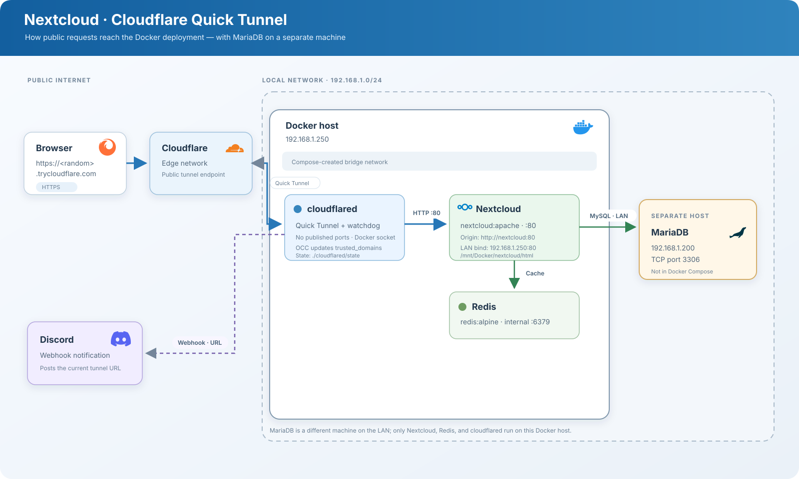

# Nextcloudflared-dyntunnel

A **Nextcloud deployment with Docker Compose** and a **Cloudflare Quick Tunnel**. When the tunnel starts or reconnects, it gets a temporary public URL, adds it to Nextcloud's `trusted_domains`, and sends it to Discord. If enabled, the previous Discord message is deleted so only the latest one remains.

> **Important:** Quick Tunnel URLs are random and change on reconnect. Anyone who knows the URL can access the public endpoint; this is not a private-access solution or a stable URL.

## How it works



- **Nextcloud** and **Redis** run in containers.
- Nextcloud uses an **external MariaDB** instance configured in `docker-compose.yaml`.
- `cloudflared` exposes Nextcloud through Cloudflare without requiring an inbound router port.
- The script supervises the tunnel, updates `trusted_domains`, and posts the URL to Discord.

## Project structure

```text
.
├── docker-compose.yaml       # Nextcloud, Redis, and cloudflared services
├── .env.example              # Environment template; copy to .env
├── architecture.svg          # Architecture diagram
└── cloudflared/
    ├── Dockerfile            # cloudflared image and helper tools
    ├── start-tunnel.sh       # Supervisor, Nextcloud update, and notification
    └── state/                # Persistent Discord message ID
```

## Requirements

- Docker Engine and Docker Compose v2.
- A MariaDB server reachable from the Docker host, with a database and user for Nextcloud.
- A Discord webhook for notifications.

### Install Docker on Debian 13

You can use the [automatic Docker installation script for Debian 13](https://github.com/fir3desert/Scripts/blob/main/Linux/Debian/install-docker-debian13.sh). Download it, review its contents, and run it:

```bash
curl -fsSLO https://raw.githubusercontent.com/fir3desert/Scripts/main/Linux/Debian/install-docker-debian13.sh
less install-docker-debian13.sh
sudo bash install-docker-debian13.sh
```

## Configuration and startup

1. Copy the template:

   ```bash
   cp .env.example .env
   ```

   Set `DB_PASSWORD` and `DISCORD_WEBHOOK_URL` in `.env`. The current tunnel script requires a Discord webhook; remove or adapt that integration if you do not want to use Discord.

2. Review `docker-compose.yaml` and adapt it to your setup:
   - Set `MYSQL_HOST`, `MYSQL_DATABASE`, and `MYSQL_USER` for your MariaDB server.
   - Change `192.168.1.250:80:80` to the LAN IP and local port you want to use.
   - Change `/mnt/Docker/nextcloud/html` to the Nextcloud data path on your host.

3. Start Nextcloud and Redis, complete the setup wizard at the configured LAN address, and confirm that Nextcloud is working:

   ```bash
   docker compose up -d redis app
   ```

4. Start the tunnel and follow its logs:

   ```bash
   docker compose up -d --build cloudflared
   docker compose logs -f cloudflared
   ```

   When the URL is announced, `cloudflared` registers it with Nextcloud and posts it to Discord.

## Operations

```bash
docker compose ps                         # Service status
docker compose logs -f cloudflared         # URL, updates, and notifications
docker compose restart cloudflared        # Generates a new URL
docker compose down                       # Stops the services
```

`DELETE_PREVIOUS_MESSAGE=true` deletes the previous Discord message. Its ID is stored under `cloudflared/state/` so it persists when the container is recreated.

## Security

- **Do not publish `.env`**: it contains the MariaDB password and webhook token. `.gitignore` excludes this file and the tunnel state.
- A Quick Tunnel is **public and unauthenticated by itself**. Use strong Nextcloud accounts and 2FA; do not share the URL in public channels.
- `cloudflared` mounts `/var/run/docker.sock` to run `occ` inside Nextcloud. Access to this socket is effectively equivalent to administrator privileges on the host.
- Bind Nextcloud's local port only to the intended network interface; check the `ports` setting before deployment.
- Replace the example IP addresses and paths in Compose and the diagram with values appropriate for your environment. Do not store secrets in those files.
